# Linkora Platform — Architecture & System Design

> **Overview:** Unified Lead-Bank, Marketplace & AI Call-Center Platform (White-Label).  
> **Repository:** Monorepo (pnpm + Turborepo, TypeScript everywhere).

---

## 1. High-Level Architecture

Linkora brings together five foundational capabilities under one architectural roof:
1. **Lead Ingestion & Quality Engine:** Phone normalization to E.164, exact & fuzzy dedup, DNC suppression, mandatory consent verification, and non-destructive quarantine.
2. **AI Scoring & Conversational QC Layer:** Versioned prompts, bidirectional PII masking, prompt-injection defense, and a guaranteed deterministic fallback engine (`RULE_BASED_FALLBACK_V1`).
3. **Lead Marketplace & Ping-Post Waterfall:** Anonymous ping payloads to candidate buyers with HMAC-signed webhooks, instant post dispatch, multi-sale resale pools, and cent-exact double-entry ledger bookkeeping.
4. **Cloud-Dialer & Telephony Gateway:** Clean `TelephonyProvider` abstraction supporting `MockTelephonyProvider`, `TelnyxProvider`, and SIP trunks. Adaptive pacing engine (Tempo 1–10) with regulatory $\le 3.0\%$ abandon rate cap.
5. **Multi-Tenant Operations & Back-Office:** PostgreSQL Row-Level Security (RLS) tenant tree, shift planning with automated leave conflict detection, HR clock-in/out, live chat, and 1-click sub-company provisioning in < 10ms.

```mermaid
flowchart TD
    subgraph Client_Layer ["Client & Front-Office Applications (apps/web)"]
        PublicSite["Public Marketing & SEO Pages\n(/, /de/photovoltaik-leads, /de/leads-verkaufen-deutschland)"]
        PanelShell["Tenant Admin & Supervisor Panel\n(/dashboard, /campaigns, /buyers, /cash-income)"]
        AgentWorkspace["Anruf-Bildschirm & Softphone\n(/call-screen, /callbacks, /hr-time)"]
    end

    subgraph API_Layer ["API & Ingestion Gateway (apps/api - NestJS)"]
        IngestAPI["Ingestion & Partner Push API\n(/api/leads, /api/leads/public-inquiry)"]
        DialerGateway["Dialer Gateway & Softphone Control\n(/api/dialer, WebSockets)"]
        MarketplaceEngine["Marketplace & Ping-Post Router\n(/api/marketplace)"]
        OpsService["Operations & Back-Office Service\n(/api/operations, /api/tenants)"]
    end

    subgraph Service_Packages ["Domain Logic Packages (packages/*)"]
        PkgAI["@linkora/ai\n(Gemini Sandbox, Fallback Scorer, PII Masking)"]
        PkgTelephony["@linkora/telephony\n(Pacing Engine, Mock & Telnyx Adapters)"]
        PkgShared["@linkora/shared\n(Zod Schemas, Permission Matrices, Types)"]
        PkgDB["@linkora/db\n(RLS Schema, SHA-256 Audit Chain, Ledger)"]
    end

    subgraph Infrastructure ["Persistence & Queue Backbone"]
        PostgreSQL[("PostgreSQL 16\n(Row-Level Security & Tenants Tree)")]
        RedisQueue[("Redis & BullMQ\n(Outbox Event Bus, Pacing State)")]
        MinIOStorage[("MinIO / S3\n(Call Recordings & Dual-Channel Audio)")]
    end

    Client_Layer --> API_Layer
    API_Layer --> Service_Packages
    Service_Packages --> Infrastructure
```

---

## 2. Multi-Tenancy & Data Isolation (PostgreSQL RLS)

Per **ADR-002**, Linkora uses Row-Level Security (RLS) rather than schema-per-tenant to provide strict cryptographic data isolation with low maintenance overhead:
- Every tenant-owned table features a `tenant_id` UUID column.
- The API sets `app.current_tenant` inside each database transaction.
- Policies ensure that tenants can only query and mutate rows where `tenant_id = current_setting('app.current_tenant')::uuid`.
- Parent companies can inspect sub-companies through hierarchical tree functions (`parent_tenant_id`) without granting cross-tenant leakage between parallel tenants.

---

## 3. Lead Commerce & Ledger Separation

A core architectural invariant is the strict separation between `leads` and `lead_sales`:
- **`leads` Table:** Represents the person and verified provenance. Never stores a "sold" boolean.
- **`lead_sales` Table:** Independent table recording each sale event (buyer, price, exclusivity, timestamp, return status).
- **Secondary Sales:** A high-quality lead can be resold multiple times across different non-competing partner networks without altering existing records.
- **Double-Entry Ledger:** All financial movements (lead sale credit, telephony minutes metering @ 0.04 €/min, return debits) are stored in append-only `ledger_entries`.

---

## 4. Telephony & AI Abstraction Interfaces

Business services never invoke telephony carriers or LLM models directly:
- **`TelephonyProvider` Interface:**
  - `originate(options)`: Initiates outbound or progressive calls.
  - `bridge(callId1, callId2)`: Bridges answered calls to free agents.
  - `hangup(callId, reason)`: Terminates line.
  - `supervise(callId, mode)`: LISTEN, WHISPER, or BARGE.
  - `getQualityMetrics(callId)`: Realtime MOS, jitter, and packet loss.
- **`LlmProvider` & Deterministic Fallback:**
  - If external AI connectivity times out or fails, Linkora automatically routes scoring through `FallbackScorer` (`RULE_BASED_FALLBACK_V1`), keeping dialers and ingestion running with zero downtime.
